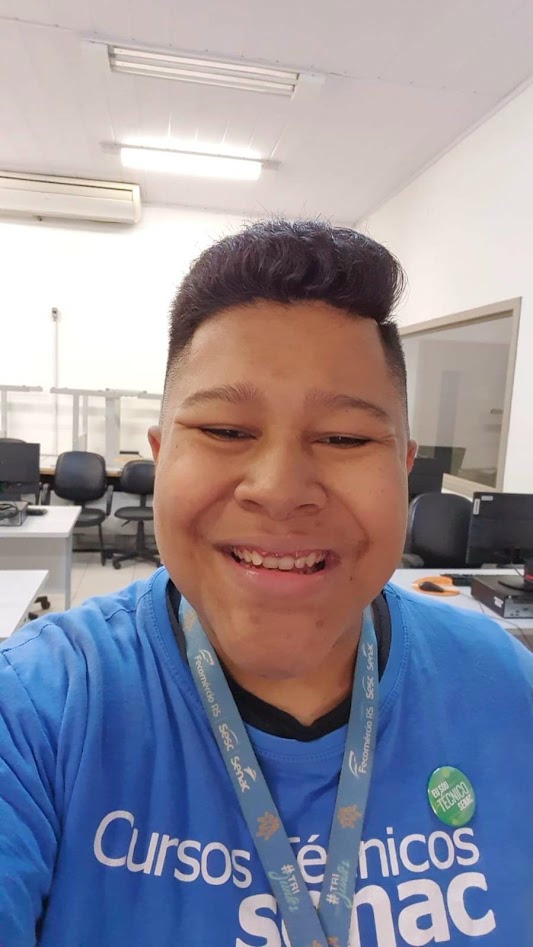

# 💎 JOIA

### Inteligência artificial a serviço de uma aprendizagem mais humana

**Educação · Programação · Acompanhamento · Autonomia**

---

## Sobre o projeto

A **JOIA** é uma assistente educacional criada para apoiar estudantes em suas
experiências com programação e inteligência artificial. Mais do que entregar
respostas, o projeto busca transformar dúvidas em oportunidades de aprendizado,
conduzindo cada aluno por um caminho de investigação, reflexão e descoberta.

Sua proposta combina a agilidade da IA com uma orientação pedagógica próxima.
Cada conversa considera o contexto do estudante e favorece explicações graduais,
pistas e perguntas que estimulem o raciocínio — sem substituir o processo de
aprender.

## Propósito

O projeto nasceu do desejo de tornar o uso da inteligência artificial em sala de
aula mais **consciente, orientado e significativo**. A JOIA procura ajudar o
estudante a desenvolver autonomia, ao mesmo tempo que oferece ao professor uma
visão mais clara de sua trajetória.

Seus princípios são:

- **orientar antes de responder**, valorizando a construção do conhecimento;
- **respeitar o ritmo de cada estudante**, reconhecendo diferentes formas de
  aprender;
- **incentivar a curiosidade**, a experimentação e o pensamento crítico;
- **aproximar professor, aluno e tecnologia** sem perder o cuidado humano;
- **acompanhar a evolução**, fazendo de cada tentativa uma parte importante da
  aprendizagem.

## Uma experiência de acompanhamento

A JOIA mantém cada jornada de aprendizagem organizada individualmente. Ao longo
das conversas, ela reúne elementos que ajudam a compreender dúvidas, avanços e
pontos que ainda merecem atenção.

Esse acompanhamento permite que a inteligência artificial atue como apoio ao
estudo, enquanto o olhar do educador continua no centro das decisões
pedagógicas. Assim, tecnologia e docência trabalham juntas para oferecer uma
orientação mais intencional e próxima.

## Versionamento

O projeto utiliza **Git** para registrar sua história e preservar a evolução de
cada etapa. As versões públicas seguem uma numeração simples e progressiva,
facilitando a identificação de mudanças relevantes na experiência, nas
orientações pedagógicas e nos recursos de acompanhamento.

> **Versão atual: 1.21**

Cada nova versão representa um ciclo de aperfeiçoamento. Mais do que adicionar
funcionalidades, o objetivo é refinar a qualidade das interações, a segurança
dos fluxos e a coerência da proposta educacional.

## Desenvolvedor

### João Carlos de Moura dos Santos

[Conheça seu perfil no LinkedIn](https://www.linkedin.com/in/joaocarlosms/)

Professor do **SENAC de Ijuí**, João Carlos de Moura dos Santos desenvolveu a
JOIA a partir de seu interesse em acompanhar de maneira mais orientada os alunos
em suas aventuras com a inteligência artificial.

Sua iniciativa parte da convicção de que a IA pode ampliar possibilidades na
educação quando utilizada com propósito, mediação e responsabilidade. A JOIA é,
portanto, um encontro entre prática docente, tecnologia e o compromisso de
ajudar estudantes a aprender com mais confiança e autonomia.

---

**JOIA** — aprender com tecnologia, crescer com orientação.

## Manual técnico

O [manual técnico da JOIA](documentacao/index.html) explica o uso do chat,
a arquitetura, as estratégias de recuperação e a operação.

## Memória vetorial dos alunos

O chat pode recuperar até duas trocas anteriores relevantes do mesmo cadastro.
Quando encontra correspondências, envia ao modelo essas trocas, as quatro
mensagens mais recentes e a pergunta atual. O histórico completo continua no
JSON privado do aluno e segue disponível para os relatórios.

Para ativar, habilite as extensões PHP `pdo_sqlite`, `curl` e `mbstring` e
configure `JOIA_VECTOR_DIR` com o caminho de um diretório privado, gravável
pelo PHP, fora da raiz pública e do repositório. O PHP cria
`joia-vetores.sqlite3` nesse diretório. Use uma pasta com acesso restrito à
conta do serviço. A configuração `OPENAI_API_KEY` também é usada para
`text-embedding-3-small`. O banco armazena somente o identificador interno,
a versão do modelo, o hash da pergunta e o vetor. A API de embeddings recebe
o texto das perguntas, que pode conter dados digitados pelo aluno.

A JOIA indexa perguntas anteriores em pequenos lotes durante o chat e
reaproveita os vetores nas próximas buscas. A comparação por cosseno é local
e percorre apenas os vetores do aluno. Se a busca for dispensada, não encontrar resultados ou o serviço estiver
indisponível, o chat usa a janela padrão de 12 mensagens. O armazenamento dos vetores é derivado e pode ser recriado a
partir do histórico. A busca usa o cadastro já associado à sessão do chat.

## Código de acesso e caderno

No primeiro cadastro, guarde o código exibido pela JOIA. Em outro dispositivo,
use **Já tenho um código** para abrir um chat limpo com o mesmo contexto
pedagógico e recuperar seu caderno. As conversas antigas ficam no arquivo
privado e podem orientar respostas futuras. Guarde o código em segredo. Em
computadores compartilhados, encerre o acesso ao terminar.

A memória dos alunos fica em `joia-memoria`, ao lado da raiz pública do servidor.
Para usar outro diretório privado e gravável pelo PHP, configure
`JOIA_MEMORY_DIR`. A hospedagem deve usar HTTPS. Na atualização, mova os arquivos
legados `memoria/aluno_*.json` para o diretório privado, preservando os nomes.
O Apache 2.4 também recebe uma regra que bloqueia o acesso HTTP à pasta legada.
Em outros servidores, remova os arquivos legados da raiz pública ao migrar;
o servidor embutido do PHP ignora regras `.htaccess`.

Um cadastro antigo ainda associado à sessão recebe um código ao abrir a JOIA.
Registros antigos sem uma sessão associada precisam de um processo de
recuperação que confirme a identidade do aluno. O caderno da versão anterior
pode ser baixado na tela de entrada do mesmo navegador e copiado para o caderno
do aluno após o acesso.

## Respostas progressivas

No chat do aluno, a pergunta permanece visível durante o envio. O PHP confirma
o recebimento antes de preparar o contexto e recebe o stream da OpenAI. Os
parágrafos autônomos seguem em eventos NDJSON antes de a geração terminar.
Caixas, tabelas e listas são renderizadas como estruturas completas. Se a API
atingir o limite de saída ou a revisão encontrar uma parte incompleta, a JOIA
pode aproveitar os parágrafos já enviados e pedir uma única continuação ao
modelo. Após a confirmação, o navegador acrescenta qualquer trecho final ainda
ausente, preservando o que já está na tela. Se a conexão cair, o chat mantém o
texto visível e marca a interrupção. O
histórico, as anotações e a leitura em voz alta usam a resposta final. Cadastro,
relatórios e clientes que pedem JSON continuam usando respostas completas.

Para confirmar o streaming em uma hospedagem, verifique se o navegador recebe
eventos progressivamente na requisição a `teste_openai.php`. Se todos os eventos
chegarem juntos, verifique o buffering de saída do PHP e da camada de proxy ou
compressão da hospedagem. A busca de contexto ocorre antes de o modelo começar
a gerar texto.

## Pistas curtas de código

Quando ajuda a responder à dúvida, a JOIA pode mostrar uma caixa com até quatro
linhas de NativeWind ou Animated do React Native, inclusive para quem está
começando. A caixa também pode ilustrar a combinação das duas tecnologias.
Pedidos de continuação retomam o objetivo mais recente na conversa. São até
três caixas somadas por aluno por dia, no horário de São
Paulo. O contador fica na memória privada do aluno e vale em outros navegadores
ou dispositivos quando ele usa seu código. Respostas que ficam em prosa e
reenvios do mesmo pedido não consomem a cota. A interface exibe o código aprovado
em uma caixa com a linguagem e o destaque de sintaxe, depois que a cota e a
resposta são salvas juntas. Dúvidas sobre hierarquia de `View` em NativeWind
podem receber uma explicação local e um exemplo revisado de contêiner e filhos
diretos, inclusive quando o aluno pede o exemplo na mensagem seguinte.

## Consumo da API

[A auditoria técnica e o guia de operação](documentacao/otimizacao-api.md) descrevem as métricas privadas, as opções de configuração e a comparação local.

## Referências da conversa e materiais do professor

Quando a dúvida aponta para um trecho de código já mostrado, a JOIA examina
o próprio trecho e tenta esclarecer o efeito no contexto. Para consultas
conceituais, o [acervo técnico local](documentacao/inteligencia-artificial.html#contexto)
ajuda a selecionar explicações pertinentes. Esse acervo complementa a conversa
recente, os materiais do professor e a memória individual do aluno.

Os materiais do professor usam um catálogo local em
`includes/materiais_didaticos.php`. Perguntas sobre onde encontrar uma aula
podem receber o título, orientação de localização e um objetivo para estudo.
O chat mostra títulos em texto simples e segue as regras pedagógicas sobre
exercícios, links e arquivos.
